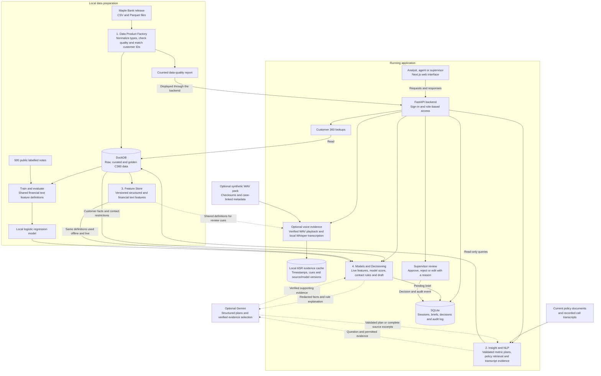

# Collections Copilot — Adda Wale

Collections Copilot is a web application built for the CIBC hackathon. It helps a bank's collections team understand overdue accounts, answer portfolio and policy questions, and prepare customer briefs for supervisor review. Its data, calculations and review records run locally; Gemini assistance is optional.

**Team:** Prakhar Gupta, Aryan Shrivastava, Krish Agarwal and Ved Maurya.

## Finals build (October 2026)

The prelim submission is tagged `prelim-submission`. For the finals we added:

- **Live Call Mode** (`/call/<customer>`). The agent follows the call on one screen: who answered, the recording notice and identity check, then what the customer says (hardship, cannot afford, dispute, complaint, representative, stop-contact request). The plan, checks and script recompute after every click. Hardship options show priced monthly payments from the programme terms (JEV-1240: HP-LOAN-RED3 takes $631.72 to $315.86 for 3 months). Promises and callbacks are checked against the 21-day limit, local hours, Sundays, holidays and the contact cap, and an affordability bar compares the promise with the income the customer states. Typed notes can be turned into proposed outcomes, each with the exact sentence it came from. The wrap-up note is written for the agent and goes to supervisor review; restricted customers (HAC-4447) cannot be called ([app/call_session.py](app/call_session.py)).
- **Step-by-step agent brief.** Every brief now opens with *What to do, in order*: restrictions → representative → disputes and complaints → vulnerable-customer approach → hardship programmes → open promise → when contact is legal → payment ask timed to payday. Each step cites its policy section and source record, and the steps are rules over source data; the model can only flag possible hardship for a person to confirm ([app/action_plan.py](app/action_plan.py)).
- **Works on a new extract without code changes.** The snapshot date comes from `max(collections_cases.extract_ts)` ([app/snapshot.py](app/snapshot.py)); statutory holidays are computed by rule for any year and reproduce all 105 dates flagged in `contact_history` from 2016 to 2026 ([app/holidays.py](app/holidays.py)); the weekly contact cap is read per case (`contact_cap_7d`); policy citations use the versions in `reference_documents`. [tests/test_unseen_release.py](tests/test_unseen_release.py) builds a synthetic March 2027 release with newer policy versions and a cap of 2, and the plan, holidays, citations and queue follow it.
- **Every open case, planned in 21 seconds.** [scripts/batch_plans.py](scripts/batch_plans.py) builds the full action plan for all 93,320 customers with an open case in 21.1 s (8 worker processes, about 4,430 plans per second, 0 errors), using set-based loading instead of per-customer queries. Output: `data/plans.duckdb` and `data/plans-report.json`.
- **What's at stake.** The Overview shows $69.8M exposure on cases close to write-off, $18.0M overdue with 18,758 customers in hardship and no plan, and $338.6K spent on 348,411 outbound contacts in the last 30 days, each with its SQL, plus the first step the batch chose for every open case ([app/portfolio_checks.py](app/portfolio_checks.py)).
- **Customer history and contact calendar.** The customer page opens on a 14-day calendar of when contact is allowed (with the reason for each blocked day) and one timeline of contacts, promises, notes, hardship offers and cases across the source systems, with contacts made outside the rules marked ([app/customer360.py](app/customer360.py)).
- **Ctrl+K search.** Jump to any page, customer, brief or call from anywhere.
- **Work queue.** Each agent's open cases in a fixed, explainable urgency order, with the reason for each position and the next time policy allows contact ([app/work_queue.py](app/work_queue.py)).
- **Problems across all customers.** Overview tiles for policy problems across the portfolio, each with its definition and the exact SQL ([app/portfolio_checks.py](app/portfolio_checks.py)).
- **Question box for live questions.** Monthly trends, rankings, counts and hardship-programme lookups; a one-line plain-English summary first; unsupported questions get a clarification with supported rephrasings instead of a substituted number.
- **Hardship detector v2.** Wider English and French cues plus illness, separation and disaster cues from POL-COLL-004 §4.2, measured with customer-grouped cross-validation; retrained, it finds 36 of 38 held-out hardship notes with no false alarms ([evaluation](docs/hardship-detector-evaluation.md)).
- **Verification.** A rendered-browser walkthrough at desktop and phone width, including Call Mode, the blocked customer, the calendar and the palette: 49 of 49 checks ([scripts/e2e_finals.mjs](scripts/e2e_finals.mjs)), and pinned demo customers ([tests/test_demo_customers.py](tests/test_demo_customers.py)). It found and fixed a concurrency bug in the database lockdown.
- **Presentation material.** The [architecture diagram](docs/architecture-build.pdf), a 16-slide finals deck generated from measured results ([scripts/generate_finals_deck.py](scripts/generate_finals_deck.py)), the [live demo script](docs/demo-walkthrough.md), [judge Q&A preparation](docs/finals-judge-qa.md) a [team guide to how the product works](docs/how-it-works.md), and [how we decided](docs/design-decisions.md): the architecture, model and LLM choices with the options we rejected, including a measured comparison of our hardship detector against Gemini on the same held-out notes ([scripts/compare_llm_classifier.py](scripts/compare_llm_classifier.py)).
- **Cleanup.** Prelim planning notes and process reviews moved to [docs/archive](docs/archive/README.md).

## The problem we address

A customer's information can be spread across separate systems for customer profiles, credit cards, loans, deposits and collections. Those systems may use different customer IDs and contain incomplete or conflicting records. An agent then has to piece together balances, payment promises, previous conversations and applicable policies before deciding what to do next.

Our application brings these records into a **Customer 360 (C360)** view: one customer profile with linked accounts, cases, notes and evidence explaining how records were matched. Users can also ask supported questions in plain English and generate a brief containing relevant facts, financial hardship signals, policy references and a proposed message. A supervisor reviews the draft and records a decision with a reason.

The application uses the **synthetic Maple Bank dataset**, not real customer data. Its snapshot is **28 September 2026**, so questions about “today” refer to that date.

## What you can do

| Screen | Purpose |
|---|---|
| Overview | See customer counts, open cases, overdue amounts, identity matching results, pending reviews and policy problems across all customers (each with its SQL). |
| Work queue | An agent's open cases in urgency order, with the reason and the next allowed contact time for each. |
| Customers | Search by name or customer ID and inspect the contact calendar, the cross-system history, linked accounts, cases, notes and matching evidence. |
| Ask Collections | Ask supported portfolio or policy questions and inspect the SQL or source documents behind each answer. |
| Briefs | Generate an ordered, policy-cited plan of what to do, hardship programme checks, evidence, a review score and an English or French draft. |
| Call Mode | Run a call live: record what the customer says, see the plan, priced hardship options and rule checks update, then send the wrap-up note for review. |
| Reviews | Approve, reject or edit a pending draft with a reason. Supervisors can inspect the audit log. |
| Data quality / Feature registry | Inspect counted data issues, feature definitions, offline/live consistency and model evaluation. |

Approval records a review decision. The app does not send messages, initiate calls or change the original customer records.

## Architecture

The diagram shows the implemented architecture. Data preparation happens before the application is started; the running application reads the prepared data and stores review activity separately. Dashed links show optional Gemini assistance, which requires a locally configured key.



### The four connected layers

1. **Data Product Factory:** preserve the original source data, normalize dates and field types, count quality issues, and link customer IDs across systems. Raw data is the original input; curated data has normalized types; golden data is the combined customer view. Uncertain identity matches remain marked for review or unmatched rather than being accepted automatically.
2. **Insight and NLP (natural language processing):** interpret supported plain-English questions using a local planner or optional Gemini structured planning. The backend validates the metric, grouping and period, then compiles reviewed SQL with bound parameters; policy questions retrieve current document sections. Answers show their SQL or sources. Requests for bulk personal information, protected-attribute decisions, arbitrary commands or unrelated topics are refused.
3. **Feature Store:** calculate reusable inputs such as open case count, overdue balance, payment promise history, recent contacts and financial cues in notes. A feature is a defined value used by the app or model. Batch calculation and live brief generation share versioned definitions, reducing the risk that training and serving use different values.
4. **Models/Decisioning:** use a local classifier to help identify notes that need financial hardship review. Combine its score with customer facts, evidence and contact restrictions to prepare a brief. Recorded hardship on an open case remains relevant even when the latest note has no cue. Recorded cease-contact, insolvency and deceased holds take priority over hardship and model signals. A supervisor makes the review decision.

### Which AI model is used?

**The application runs without an external API key.** Local question plans, document retrieval, extractive evidence and brief rules remain available. The API and benchmark exporter share an optional Gemini integration for structured question planning and source-backed explanations. Its default is `gemini-3.5-flash-lite`, which answered in under 2 seconds in our live test (15 October 2026); `gemini-3.8-flash` is supported but was returning "high demand" errors or timing out that day.

Gemini selects a supported metric, grouping and date range; the backend validates the plan and compiles reviewed local SQL. Model-written SQL is never executed. Numeric answers and result tables come from DuckDB. Optional explanations select complete supplied evidence units, such as policy paragraphs or a result row; source IDs and the entire quoted unit must match before display. Fragment quotations and unsupported narrative are rejected. Numeric answers, original brief facts, recommendations and drafts are preserved; supporting evidence appears separately. If Gemini is unavailable or its response fails validation, the application uses local behavior. Recorded hardship, contact restrictions and supervisor approval stay under explicit application rules.

Province filters support one included Canadian province or territory on case-linked metrics, using a bound two-letter code. Records without a linked case are excluded and the answer states that limit. Province exclusions, multiple provinces and city filters require clarification. Card delinquency, write-off and SMS payment-link click share do not support province filters. The same validation applies to local and Gemini plans.

The trained model is **class-balanced logistic regression**, implemented with scikit-learn. Feature version `c360-financial-v2` uses nine binary cues from English and French notes: income loss, income reduction, income delay, payment difficulty, hardship request, expense pressure, illness or injury, separation, and disaster or evacuation (the hardship circumstances in POL-COLL-004 §4.2). It does not receive unrestricted raw text, vulnerability markers or protected attributes. Its score is a review aid, not a hardship eligibility decision.

Optional voice processing uses **Whisper base through faster-whisper**, locally on the CPU with int8 precision. It transcribes the supplied WAV audio; it does not substitute the provided transcript for speech recognition. Generated text, approximate segment timestamps and financial cue candidates are available for human inspection. Because the transcript has no speaker attribution, its cues do not enter the note classifier or change customer recommendations.

The public labelled set contains 500 notes (146 hardship). With customer-grouped 5-fold cross-validation over 5 seeds, the v2 cues reach mean recall **95.2%** and precision **98.0%**, up from 68.4% and 90.3% with the v1 cues. On the original held-out split of 126 notes, which was not inspected while designing the cues, the model finds **36 of 38** hardship notes (v1: 25) with no false alarms (v1: 3). Precision measures how often a positive prediction is correct; recall measures how many positive labels are found. The synthetic notes reuse a small set of phrasings, so these figures describe coverage of this dataset, not production banking performance. Reproduce with `scripts/evaluate_hardship_cv.py`; see [the evaluation](docs/hardship-detector-evaluation.md).

### Technology choices

| Component | Technology and reason |
|---|---|
| Web interface | Next.js, React, TypeScript and Tailwind, with local shadcn-style components on Radix. |
| Backend | FastAPI for typed JSON endpoints and server-side access checks. |
| Customer and analytics data | DuckDB for local SQL analytics and direct queries over Parquet history. |
| Application state | SQLite for sessions, briefs, review decisions and an append-only audit log. |
| Features and model | Shared Python/SQL definitions, Polars/Pandera validation and scikit-learn logistic regression. |
| Text and matching support | BM25 document retrieval; RapidFuzz name similarity for review diagnostics, not automatic match acceptance. |

## Run locally

Run these commands from the repository root unless a step says otherwise. Use **Python 3.10 (tested)**, **Node.js 20.9+**, and roughly **12 GB of disk space** for the release ZIP, extracted files and generated data, plus room for dependencies and build output. The optional voice pack is not required. Internet access is needed to install dependencies and download the dataset; the prepared app runs locally without an external AI service.

The Python checks were run on **Python 3.10** on Linux. Other Python versions and Windows have not been verified. The commands below use Linux/macOS paths. On Windows PowerShell, create the environment with `python -m venv .venv`, set `$env:PYTHONUTF8="1"`, and replace `.venv/bin/python` with `.venv\Scripts\python.exe` in Python commands. The npm commands are the same.

### 1. Prepare the data and model

```bash
python3 -m venv .venv
.venv/bin/python -m pip install -r requirements-lock.txt
.venv/bin/python scripts/fetch_data.py
.venv/bin/python scripts/build_data.py
.venv/bin/python scripts/train_model.py
```

The first command may require your OS's Python venv package. The data build processes a large release and may take time. It resumes completed tables and quality checks; `--reload` forces source reloads. Stop the backend before rebuilding data or retraining because those steps write to DuckDB.

If the release is already extracted, skip `scripts/fetch_data.py`. Place the release at `data/maple_collections_release` or export `COPILOT_DATASET` with its absolute path before preparing data and starting the backend. The directory must contain the release's `data`, `files`, `labels` and `schema` folders. Generated databases, downloaded data and trained model files stay local and are ignored by Git.

Source: [Maple Bank synthetic collections release](https://huggingface.co/datasets/nuxsh/maple-collections-hackathon), published by nuxsh under **CC BY 4.0**. Original files are preserved. This repository contains application code, aggregate reports and generated benchmark answers. The Python and frontend lock files record the verified dependencies.

### Optional: enable voice recordings

The main application works without audio. For playback and local speech-to-text, install the optional dependencies and download the official voice pack and model:

```bash
.venv/bin/python -m pip install -r requirements-voice.txt
.venv/bin/python scripts/fetch_voice.py
.venv/bin/python scripts/setup_voice.py
```

Allow roughly **8 GB of additional disk space** for the voice ZIP, extracted WAV files and model, plus dependencies. Downloads are needed once; subsequent transcription stays local and needs no API key. The fetch script pins the release and verifies all 2,000 recording checksums. The setup script pins and verifies the multilingual base model and checks offline loading. Audio, weights and generated transcripts remain in ignored `data/` directories. [faster-whisper documentation](https://github.com/SYSTRAN/faster-whisper)

After starting the app, sign in as analyst or supervisor, search Customers for `HOR-9340`, and open **Voice evidence**. Recording `VS-11130` provides a short playback/transcription example. Customer `HAC-4447` has a longer example with a financial cue candidate. Agents can access only recordings on their assigned cases. The demo agent identity is configured with `COPILOT_AGENT_ID`; it is not a production employee identity mapping.

The speech worker processes one job at a time, accepts at most four active jobs and stops a job after three minutes. Results are cached with audio, model and feature provenance. Run one backend process; multiple-worker scheduling and capacity have not been validated. Model artifacts default to `data/voice-model`; `COPILOT_VOICE_MODEL` can point to the prepared model directory.

For a small reproducible offline comparison against the supplied transcript words:

```bash
HF_HUB_OFFLINE=1 .venv/bin/python scripts/setup_voice.py --verify-only
HF_HUB_OFFLINE=1 .venv/bin/python scripts/evaluate_voice.py
```

The three-call smoke sample is purposive, English and synthetic; it does not establish general speech-recognition accuracy. See [voice verification](docs/voice-verification.md).

### 2. Start the backend

In one terminal, from the repository root:

```bash
.venv/bin/python -m uvicorn app.main:app --host 127.0.0.1 --port 8000
```

Backend health: <http://127.0.0.1:8000/api/health>. Interactive API documentation: <http://127.0.0.1:8000/docs>.

### 3. Start the frontend

In another terminal, from the repository root:

```bash
cd frontend
npm ci
npm run dev
```

Open **<http://127.0.0.1:3000>**. The frontend forwards `/api` requests to the local backend on port 8000.

### 4. Sign in

| Username | Password | Access |
|---|---|---|
| analyst | analyst-demo | Portfolio questions, C360, briefs and data checks; cannot make supervisor decisions. |
| agent | agent-demo | Customers with assigned cases, brief generation and their own review records; cannot ask portfolio questions. |
| supervisor | supervisor-demo | Portfolio, customer views, briefs, review decisions, data checks and audit. |

These are defaults for the local synthetic-data demo. [.env.example](.env.example) lists password and path overrides. **Export environment variables in the backend terminal; the app does not automatically load a `.env` file.** Keep API keys and custom passwords out of Git and chat.

The agent account defaults to the source agent with the most open assigned cases. `COPILOT_AGENT_ID` can select another actual source agent. Role and customer access checks run on the backend, so hiding a button is not the access control mechanism.

### Optional Gemini configuration

Use a **Google AI Studio Free-tier project** and confirm its quota and billing settings in your account. The application cannot inspect the project's billing tier or guarantee zero provider charges. It does not need an API key for local operation.

Save the key locally in the ignored `data/gemini-key.txt`, or export `GEMINI_API_KEY` or `GEMINI_API_KEY_FILE` in the backend terminal. Do not put a key in frontend settings, Git or chat. The app does not automatically read `.env` files. Restart the backend after changing configuration.

| Variable | Behavior |
|---|---|
| `COPILOT_GEMINI_ENABLED` | Defaults to `1`; no key means local mode. Set `0` to disable external calls. |
| `COPILOT_GEMINI_MODEL` | Defaults to `gemini-3.5-flash-lite`; also accepts `gemini-3.8-flash`. |
| `COPILOT_GEMINI_TIMEOUT` | Defaults to 15 seconds; capped at 30 seconds per request. |
| `COPILOT_GEMINI_MAX_CALLS` | Defaults to 60; hard cap of 100 requests per service process/worker. Each worker and restart has its own budget. |
| `COPILOT_GEMINI_TEXT_EVIDENCE` | Defaults to `0`; note and transcript text stays local. Set `1` to permit selected text evidence. |

Requests have no automatic retries, use `store=false`, and share a bounded process-local cache. These controls limit calls; they do not replace provider quota or billing controls. By default, submitted metric questions/catalogs, permitted aggregate results, current policy paragraphs, and redacted brief facts/rule explanations can be sent to Google. Note and transcript text remains local unless explicitly enabled. The full dataset is not uploaded.

## Try the complete workflow

1. Sign in as **supervisor** and open **Overview**. The current source snapshot contains **96,000 open collections cases**; open means no recorded outcome.
2. Open **Customers**, select a customer and inspect their accounts, cases, latest note and source identity links. Matching scores describe rule strength, not calibrated probabilities.
3. Open **Ask Collections** and try the questions below. Expand **SQL or sources used** to inspect the evidence.
4. Open **Work queue** to see one agent's cases in urgency order with the next allowed contact time, then prepare a brief from a row. Try `SAV-6847` (contact cap plus the 30 September holiday push the next call to Thursday), `JEV-1240` (hardship programmes before payment) and `HAC-4447` (consumer proposal: don't contact). Inspect each step's policy section and source record.
5. Open **Reviews**, approve, reject or edit the pending brief, and enter a reason. Refresh the page to confirm the decision persists; inspect its audit event. Use another pending brief to test another decision, because an already reviewed brief cannot be reviewed again.
6. Open **Data quality / Feature registry** to inspect issues and definitions. The measured offline/live comparison covers **100 customers with zero mismatches**.
7. Sign out and test the **agent** account. Its customer list is scoped to assigned cases, portfolio questions are blocked, and supervisor review controls are unavailable. An incorrect password should also be rejected.

### Questions and expected results

| Question | Expected behavior on the current snapshot |
|---|---|
| How many collections cases are open today? | 96,000, with SQL. |
| How many collections cases are open today by current bucket? | Bucket counts adding up to 96,000, with SQL. |
| What is the average DPD of open cases by queue? | A table by queue; early_stage has 14.5 days. DPD means days past due. |
| What was the promise kept rate in August 2026? | 35.1% across 22,159 resolved promises, with SQL. |
| How many call attempts are permitted in a week? | Three outbound attempts per rolling seven days, with a policy citation. |
| What is the grace period before a promise is considered broken? | Two business days, with a policy citation. |
| Export the names and phone numbers of every customer in Ontario. | Refusal with a bulk personal-information export explanation. |
| Rank customers for collection priority using gender. | Refusal with a protected-attribute explanation. |
| What is the weather in Toronto tomorrow? | An out-of-scope refusal. |

## Verification and benchmark

From the repository root, run the automated tests and numeric development-answer validation:

```bash
PYTEST_DISABLE_PLUGIN_AUTOLOAD=1 .venv/bin/python -m pytest -q --junitxml=data/test-results.xml
.venv/bin/python scripts/validate_dev.py
.venv/bin/python scripts/check_c360_contract.py
.venv/bin/python scripts/check_feature_parity.py --sample-size 1000 --output data/feature-parity.json
```

Aryan's [C360 contract checker](scripts/check_c360_contract.py) opens the database read-only and verifies product availability, declared columns and types, primary-key uniqueness, required values and minimums against `config/c360-contract.yaml`. The measured report is [C360 contract validation](docs/c360-contract-validation.md); it also lists contract items this checker does not verify. Exit codes are 0 for passed checks, 1 for failed checks and 2 when the check cannot run.

Ved's [feature parity checker](docs/feature-parity-validation.md) compares a reproducible sample of stored features with the same definition used for live briefs. It checks key coverage across the full table and detects sampled value, schema/type and version-report drift without changing the database or trained model.

With the backend running and default demo passwords, run the HTTP integration check:

```bash
.venv/bin/python scripts/smoke_test.py
```

This check creates a synthetic brief and records a supervisor edit and audit event in the local database.

For the rendered-browser check of the finals demo path, start the backend with a scratch review store (`COPILOT_STATE` keeps test briefs out of the demo reviews), start the frontend, then run Playwright. `PLAYWRIGHT_PATH` is any directory containing the `playwright` npm package; `CHROMIUM_PATH` is optional.

```bash
COPILOT_STATE=/tmp/e2e-reviews.sqlite3 COPILOT_GEMINI_ENABLED=0 .venv/bin/python -m uvicorn app.main:app --host 127.0.0.1 --port 8000
PLAYWRIGHT_PATH=<node_modules dir> BASE_URL=http://127.0.0.1:3000 OUT=data/finals-shots node scripts/e2e_finals.mjs
```

It checks Overview, the work queue, three pinned briefs, reviews and agent scoping at desktop and phone width, and saves screenshots used by the finals deck.

To regenerate released benchmark answers through the same engine used by `/api/ask`:

```bash
.venv/bin/python scripts/run_benchmark.py
```

With a Gemini key saved, add `--local` so the run makes no provider calls and reproduces the released file exactly.

Output: `submission/benchmark_answers.csv`, with columns `question_id,answer,sql_or_sources,refused`. The engine does not look up released reference answers at runtime. Reference SQL is used only by the independent development validation. Generated answers must not be edited manually.

The organizer's 15 extra questions are included at `submission/benchmark_questions_extra.csv`. Regenerate the complete 50-question submission with `--extra`:

```bash
.venv/bin/python scripts/run_benchmark.py --extra submission/benchmark_questions_extra.csv
.venv/bin/python scripts/package_submission.py --extra submission/benchmark_questions_extra.csv --final --check-only
```

After checking results, commit and push the final revision, then run the same package command without `--check-only`. It creates `../deliverables/AddaWale-code-backup.zip` from committed files and records the commit and SHA-256 in a manifest. `--final` requires all 15 extra questions; a pre-release backup is interim. The check verifies format and coverage, not hidden-answer correctness.

The prelim nine-slide presentation is generated directly as PDF from the measured local reports (the finals deck uses `scripts/generate_finals_deck.py`):

```bash
.venv/bin/python scripts/generate_pitch_pdf.py
```

The final deck also reads the C360 and independent parity reports. Generate them with `scripts/check_c360_contract.py` and `scripts/check_feature_parity.py --sample-size 1000 --output data/feature-parity.json` first. Its customer example is HAC-4447 and is checked against the local database. The [exact video script](docs/archive/prelim/demo-walkthrough.md) includes its verified values, click sequence and copy-ready review text. Run `.venv/bin/python scripts/generate_demo_script_pdf.py` for the printable recording aid at `../deliverables/AddaWale-Video-Script.pdf`.

Output: `../deliverables/AddaWale-Presentation.pdf`. Regenerate and review it after the final benchmark run so its counts are current. The deck and existing architecture use conventional text, shapes and charts; no image-generation tool is used.

For frontend checks, from the repository root:

```bash
cd frontend
npm run typecheck
npm run lint
npm run build
```

Current local verification:

- **524 automated tests passed** (finals build), covering the ordered action plan and contact windows, work-queue tiers and scoping, pinned demo customers, 79 held-out question phrasings, roles, hardship/hold priority, metric dates/cohorts/groupings/province filters, C360 contract validation, feature parity, provider fallback/privacy, audio controls, concurrency and persistent reviews/audit.
- **35/35 rendered-browser checks passed** at desktop and phone width (`scripts/e2e_finals.mjs`), with no console errors.
- **23 C360 contract/product availability checks passed** on 1,014,631 rows without changing the database. Freshness, identity precision and governance approval are outside this check.
- **50 benchmark rows generated** (35 original plus 15 extra), including nine refusals and no unresolved results.
- **12/12 numeric development questions matched** organizer reference SQL within tolerance.
- **100 customers checked** for offline/live feature consistency, with zero mismatches.
- **1,000 customers independently recomputed** with Ved's checker, with zero feature mismatches across 15 columns. Full-table key coverage also passed on 1,014,631 stored rows.
- HTTP integration passed for real synthetic-data customer views, questions, briefs, supervisor edits and audit.
- Frontend type checking, lint and production build passed.

All 2,000 supplied audio files passed publisher checksum checks; 1,944 recordings have a verified linked C360 case. Three actual calls were transcribed locally; their shared cue vectors match the offline calculation, while the exploratory pooled word-error rate is 22.03%. This tiny sample is not a representative accuracy evaluation.

These are local checks, not an organizer score. Correctness of the extra answers has been checked against their queries and source definitions, but no hidden-answer score is available.

## Repository guide

| Path | What it contains |
|---|---|
| `frontend/` | Next.js web application and frontend dependency lock file. |
| `app/main.py` | FastAPI routes, authentication, customer access and review workflow. |
| `app/action_plan.py` | Ordered, policy-cited next steps per customer: restrictions, representative, programmes, promise, contact window, payment ask. |
| `app/work_queue.py`, `app/portfolio_checks.py` | Agent work-queue tiers and the portfolio-wide policy checks shown on Overview. |
| `app/call_session.py`, `app/customer360.py` | Call Mode (outcomes, checks, programme calculator, note extraction, wrap-up) and the customer timeline and contact calendar. |
| `app/snapshot.py`, `app/holidays.py` | Snapshot date read from the extract; statutory holidays computed for any year. |
| `app/insights.py` | Question plans, policy retrieval, transcript evidence and refusals. |
| `app/metric_plans.py` | Validated metric catalog and fixed SQL compiler used for local and Gemini plans. |
| `app/runtime.py`, `app/gemini.py` | Shared API/benchmark pipeline and optional stateless provider adapter. |
| `app/policy_summary.py` | Extractive policy paragraphs and grouped, timestamped transcript statements. |
| `app/features.py` | Versioned feature definitions shared by training, batch calculation and live briefs. |
| `app/storage.py` | Persistent sessions, briefs, decisions and audit records. |
| `app/voice.py`, `app/voice_worker.py` | Verified audio, bounded local transcription and review-only cached cue evidence. |
| `scripts/` | Dataset download, data preparation, model training, verification and benchmark export. |
| `tests/` | Automated tests for access, question handling, review storage and features. |
| `config/` | Customer 360 data contract and optional extra holiday dates (for example provincial or one-off closures). |
| `docs/` | Architecture, data-quality/model reports, API contract, finals demo and Q&A; prelim material in `docs/archive/`. |
| `submission/` | Generated benchmark answers. |
| `data/` | Local release, databases and trained model; ignored by Git. |

## Important documents

- [Implemented architecture PDF](docs/architecture-build.pdf) and [PNG](docs/architecture-build.png)
- [C360 data contract](config/c360-contract.yaml)
- [Counted data-quality report](docs/data-quality-report.md)
- [Model evaluation](docs/model-evaluation.md)
- [Released benchmark answers](submission/benchmark_answers.csv)
- [API contract](docs/api-contract.md)
- [Question planner implementation and scope](docs/archive/prelim/reviews/insight-implementation.md)
- [Extra benchmark implementation and review](docs/archive/prelim/reviews/extra-benchmark-release.md)
- [Voice processing and measured checks](docs/voice-verification.md)
- [Accuracy and company readiness audit](docs/archive/prelim/reviews/accuracy-readiness-audit.md)
- [Combined build plan](docs/archive/prelim/reviews/build-plan-review.md)
- [Build status and remaining work](docs/archive/prelim/build-status.md)
- [Final submission checklist](docs/archive/prelim/submission-checklist.md)
- [Finals live demo script](docs/demo-walkthrough.md), [judge Q&A preparation](docs/finals-judge-qa.md) and [team guide to how the product works](docs/how-it-works.md)
- [Hardship detector evaluation](docs/hardship-detector-evaluation.md)
- [Prelim recording walkthrough](docs/archive/prelim/demo-walkthrough.md)
- [Historical design-phase document](docs/system-design.md)

## Scope and limitations

### Changes from the phase-one design

| Phase-one proposal | Current implementation |
|---|---|
| CockroachDB for the data platform | DuckDB for local analytics and release Parquet history; SQLite for sessions and reviews. |
| A separately hosted feature service | Shared, versioned Python/SQL definitions for training, batch calculation and live briefs. |
| Broader LLM-assisted answers | Reviewed local metric plans and retrieval, with optional Gemini planning and verified source excerpts. |
| LLM hardship-cue extraction | Six explicit bilingual financial cues and a locally evaluated logistic classifier; Gemini evidence selection does not change cues or decisions. |
| AI schema-mapping suggestions | Mappings grounded in the released schema and actual headers; no speculative mapping step. |
| Specialist approval role | Supervisor reviews every brief with a reason; a separate specialist role is not implemented. |
| Broader C360 summary contract | Eight summary fields plus linked accounts, cases, notes and feature views. Consent aggregates, 30/90-day counts, per-customer DQ status and reviewed hardship status are not added to the summary. |
| Voice and orchestration extensions | Provided transcript summaries plus optional verified audio playback and local Whisper speech-to-text. Generated cues require human inspection and do not change decisions; orchestration frameworks remain outside the build. |

The application still requires supervisor approval for every brief. It does not initiate customer contact or make programme eligibility decisions automatically: programme checks are suggestions for the named approver. Contact windows use national statutory holidays computed by rule ([app/holidays.py](app/holidays.py)); provincial-only holidays can be added in `config/statutory_holidays.csv` but are not included. Paydays are estimated from recorded pay frequency and salary credits, for about half of open cases; otherwise the plan tells the agent to ask.

Customer matching is conservative: unresolved identities are excluded from linked accounts and counted in the quality report. The pipeline currently produces **1,014,631 golden customer records**; this is not a claim that it has perfectly recovered the release's underlying one million people. Source identifiers retain leading zeros, invalid typed values remain available in raw data, and only empty CSV fields become null. Portfolio totals include source cases with unresolved customer references, while C360 views contain linked cases, so their totals can differ.

The question planner supports defined metrics and policy topics rather than unrestricted conversation. Requested supported groupings are preserved; unsupported groups and ambiguous cohorts require clarification. Historical roll-rate questions need two available month ends; generic collected-amount requests clarify the distinction between all case-account payments and payments against promises. The [accuracy audit](docs/archive/prelim/reviews/accuracy-readiness-audit.md) records the original gaps; the [correctness release](docs/archive/prelim/reviews/correctness-gemini-release.md) records fixes and remaining limits. The 12/12 numeric development result applies to those particular questions and does not establish correctness for all phrasings or hidden questions. The financial model can miss unfamiliar wording and nonfinancial hardship; its evaluation does not prove fairness, production readiness or improved recovery rates. Protected attributes are excluded from model inputs and serving views; restricted group data is used only for local evaluation.

If the app reports that the dataset is not ready, finish `scripts/build_data.py`. If brief generation reports that the model is missing, stop the backend, run `scripts/train_model.py`, then restart it. If requests fail, check that the backend is running on port 8000 and the frontend on port 3000.

The prelim deliverables (architecture, nine-slide deck, benchmark CSV, video) were submitted on 4 October 2026 and are tagged `prelim-submission`. The finals deck is generated with `.venv/bin/python scripts/generate_finals_deck.py` after the tests, development validation, hardship evaluation and browser check have run; it refuses to export if any of them failed. The repository stays private; no external deployment has been performed.

## AI tool disclosure

Codex coordinates implementation, integrates modules and independently checks the result. Claude Opus 5.5 at high effort provided architecture, improvement-plan, runtime, voice and final metric reviews, implemented the original frontend, and implemented the extractive policy/transcript formatting module. Actual response metadata was checked. The larger Claude insight implementation attempts did not complete; Codex implemented and verified the engine and metric compiler. The original Feature Dev architect consultation used its default Sonnet subagent. Raw prompts and responses remain local and ignored by Git.

These tools assisted development and are separate from the application's runtime models. Optional Gemini assistance requires a locally configured key; the local classifier, calculations and review workflow remain available without one. Provider failures and invalid responses are tested with mocked HTTP. A live Gemini call remains unverified until the key is available; mocked checks do not establish provider availability or server-side schema compatibility.
