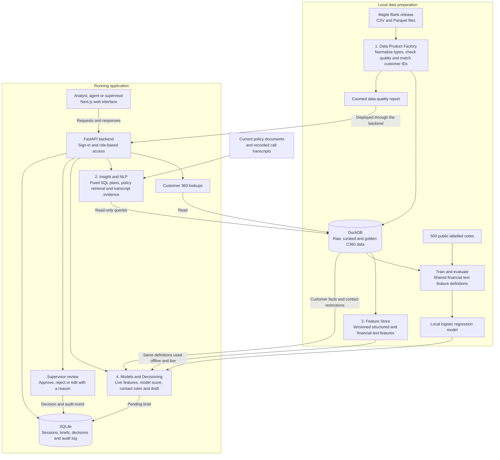

# Collections Copilot — Adda Wale

Collections Copilot is a local web application built for the CIBC hackathon. It helps a bank's collections team understand overdue accounts, answer portfolio and policy questions, and prepare customer briefs for supervisor review.

**Team:** Prakhar Gupta, Aryan Shrivastava, Krish Agarwal and Ved Maurya.

## The problem we address

A customer's information can be spread across separate systems for customer profiles, credit cards, loans, deposits and collections. Those systems may use different customer IDs and contain incomplete or conflicting records. An agent then has to piece together balances, payment promises, previous conversations and applicable policies before deciding what to do next.

Our application brings these records into a **Customer 360 (C360)** view: one customer profile with linked accounts, cases, notes and evidence explaining how records were matched. Users can also ask supported questions in plain English and generate a brief containing relevant facts, financial hardship signals, policy references and a proposed message. A supervisor reviews the draft and records a decision with a reason.

The application uses the **synthetic Maple Bank dataset**, not real customer data. Its snapshot is **28 September 2026**, so questions about “today” refer to that date.

## What you can do

| Screen | Purpose |
|---|---|
| Overview | See customer counts, open cases, overdue amounts, identity matching results and pending reviews. |
| Customers | Search by name or customer ID and inspect linked accounts, cases, notes and matching evidence. |
| Ask Collections | Ask supported portfolio or policy questions and inspect the SQL or source documents behind each answer. |
| Briefs | Generate a customer summary, financial hardship review score, evidence, policy references and an English or French draft. |
| Reviews | Approve, reject or edit a pending draft with a reason. Supervisors can inspect the audit log. |
| Data quality / Feature registry | Inspect counted data issues, feature definitions, offline/live consistency and model evaluation. |

Approval records a review decision. The app does not send messages, initiate calls or change the original customer records.

## Architecture

The diagram shows the implemented local architecture. Data preparation happens before the application is started; the running application reads the prepared data and stores review activity separately.



### The four connected layers

1. **Data Product Factory:** preserve the original source data, normalize dates and field types, count quality issues, and link customer IDs across systems. Raw data is the original input; curated data has normalized types; golden data is the combined customer view. Uncertain identity matches remain marked for review or unmatched rather than being accepted automatically.
2. **Insight and NLP (natural language processing):** interpret supported plain-English questions using a local planner. Portfolio questions run fixed SQL templates with bound parameters; policy questions retrieve current document sections. Answers show their SQL or sources. Requests for bulk personal information, protected-attribute decisions, arbitrary commands or unrelated topics are refused.
3. **Feature Store:** calculate reusable inputs such as open case count, overdue balance, payment promise history, recent contacts and financial cues in notes. A feature is a defined value used by the app or model. Batch calculation and live brief generation share versioned definitions, reducing the risk that training and serving use different values.
4. **Models/Decisioning:** use a local classifier to help identify notes that need financial hardship review. Combine its score with customer facts, evidence and contact restrictions to prepare a brief. Recorded cease-contact, insolvency and deceased holds take priority over the model. A supervisor makes the review decision.

### Which AI model is used?

**No external large language model (LLM) API is connected, including a free-tier API. Runtime API cost is zero.** Ask Collections uses fixed query plans and document retrieval; call summaries extract source evidence; drafts use templates and rules.

The trained model is **class-balanced logistic regression**, implemented with scikit-learn. It uses six binary financial cues from English and French notes: income loss, income reduction, income delay, payment difficulty, hardship request and expense pressure. It does not receive unrestricted raw text or protected attributes. Its score is a review aid, not a hardship eligibility decision.

The public labelled set contains 500 notes. Training uses 374 notes and evaluation uses 126, with customers kept separate between the two groups to reduce data leakage. Heldout precision is **89.29%**, recall **65.79%**, and F1 **75.76%**. Precision measures how often a positive prediction is correct; recall measures how many positive labels are found; F1 balances the two. These results apply to this small synthetic dataset, not production banking performance.

### Technology choices

| Component | Technology and reason |
|---|---|
| Web interface | Next.js, React, TypeScript and Tailwind, with local shadcn-style components on Radix. |
| Backend | FastAPI for typed JSON endpoints and server-side access checks. |
| Customer and analytics data | DuckDB for local SQL analytics and direct queries over Parquet history. |
| Application state | SQLite for sessions, briefs, review decisions and an append-only audit log. |
| Features and model | Shared Python/SQL definitions, Polars/Pandera validation and scikit-learn logistic regression. |
| Text and matching support | BM25 document retrieval; RapidFuzz name similarity for review diagnostics, not automatic match acceptance. |

## Run locally

Run these commands from the repository root unless a step says otherwise. You need **Python 3.10+**, **Node.js 20.9+**, and roughly **12 GB of disk space** for the release ZIP, extracted files and generated data, plus room for dependencies and build output. The optional voice pack is not required. Internet access is needed to install dependencies and download the dataset; the prepared app runs locally without an external AI service.

### 1. Prepare the data and model

```bash
python3 -m venv .venv
.venv/bin/python -m pip install -r requirements-lock.txt
.venv/bin/python scripts/fetch_data.py
.venv/bin/python scripts/build_data.py
.venv/bin/python scripts/train_model.py
```

The first command may require your OS's Python venv package. The data build processes a large release and may take time. It resumes completed tables and quality checks; `--reload` forces source reloads. Stop the backend before rebuilding data or retraining because those steps write to DuckDB.

If the release is already extracted, skip `scripts/fetch_data.py`. Place the release at `data/maple_collections_release` or export `COPILOT_DATASET` with its absolute path before preparing data and starting the backend. The directory must contain the release's `data`, `files`, `labels` and `schema` folders. Generated databases, downloaded data and trained model files stay local and are ignored by Git.

Source: [Maple Bank synthetic collections release](https://huggingface.co/datasets/nuxsh/maple-collections-hackathon), published by nuxsh under **CC BY 4.0**. Original files are preserved. This repository contains application code, aggregate reports and generated benchmark answers. The Python and frontend lock files record the verified dependencies.

### 2. Start the backend

In one terminal, from the repository root:

```bash
.venv/bin/python -m uvicorn app.main:app --host 127.0.0.1 --port 8000
```

Backend health: <http://127.0.0.1:8000/api/health>. Interactive API documentation: <http://127.0.0.1:8000/docs>.

### 3. Start the frontend

In another terminal, from the repository root:

```bash
cd frontend
npm ci
npm run dev
```

Open **<http://127.0.0.1:3000>**. The frontend forwards `/api` requests to the local backend on port 8000.

### 4. Sign in

| Username | Password | Access |
|---|---|---|
| analyst | analyst-demo | Portfolio questions, C360, briefs and data checks; cannot make supervisor decisions. |
| agent | agent-demo | Customers with assigned cases, brief generation and their own review records; cannot ask portfolio questions. |
| supervisor | supervisor-demo | Portfolio, customer views, briefs, review decisions, data checks and audit. |

These are defaults for the local synthetic-data demo. [.env.example](.env.example) lists password and path overrides. **Export environment variables in the backend terminal; the app does not automatically load a `.env` file.** Keep API keys and custom passwords out of Git and chat.

The agent account defaults to the source agent with the most open assigned cases. `COPILOT_AGENT_ID` can select another actual source agent. Role and customer access checks run on the backend, so hiding a button is not the access control mechanism.

## Try the complete workflow

1. Sign in as **supervisor** and open **Overview**. The current source snapshot contains **96,000 open collections cases**; open means no recorded outcome.
2. Open **Customers**, select a customer and inspect their accounts, cases, latest note and source identity links. Matching scores describe rule strength, not calibrated probabilities.
3. Open **Ask Collections** and try the questions below. Expand **SQL or sources used** to inspect the evidence.
4. Generate a brief from a customer record. Compare its case count and overdue amount with the customer view, and inspect the financial cues, model details, policies and draft.
5. Open **Reviews**, approve, reject or edit the pending brief, and enter a reason. Refresh the page to confirm the decision persists; inspect its audit event. Use another pending brief to test another decision, because an already reviewed brief cannot be reviewed again.
6. Open **Data quality / Feature registry** to inspect issues and definitions. The measured offline/live comparison covers **100 customers with zero mismatches**.
7. Sign out and test the **agent** account. Its customer list is scoped to assigned cases, portfolio questions are blocked, and supervisor review controls are unavailable. An incorrect password should also be rejected.

### Questions and expected results

| Question | Expected behavior on the current snapshot |
|---|---|
| How many collections cases are open today? | 96,000, with SQL. |
| How many collections cases are open today by current bucket? | Bucket counts adding up to 96,000, with SQL. |
| What is the average DPD of open cases by queue? | A table by queue; early_stage has 14.5 days. DPD means days past due. |
| What was the promise kept rate in August 2026? | 35.1% across 22,159 resolved promises, with SQL. |
| How many call attempts are permitted in a week? | Three outbound attempts per rolling seven days, with a policy citation. |
| What is the grace period before a promise is considered broken? | Two business days, with a policy citation. |
| Export the names and phone numbers of every customer in Ontario. | Refusal with a bulk personal-information export explanation. |
| Rank customers for collection priority using gender. | Refusal with a protected-attribute explanation. |
| What is the weather in Toronto tomorrow? | An out-of-scope refusal. |

## Verification and benchmark

From the repository root, run the automated tests and numeric development-answer validation:

```bash
PYTEST_DISABLE_PLUGIN_AUTOLOAD=1 .venv/bin/python -m pytest -q
.venv/bin/python scripts/validate_dev.py
```

With the backend running and default demo passwords, run the HTTP integration check:

```bash
.venv/bin/python scripts/smoke_test.py
```

This check creates a synthetic brief and records a supervisor edit and audit event in the local database.

To regenerate released benchmark answers through the same engine used by `/api/ask`:

```bash
.venv/bin/python scripts/run_benchmark.py
```

Output: `submission/benchmark_answers.csv`, with columns `question_id,answer,sql_or_sources,refused`. The engine does not look up released reference answers at runtime. Reference SQL is used only by the independent development validation. Generated answers must not be edited manually.

When the organizer releases extra questions at **19:00 IST on 4 October 2026**, include their file with `--extra`:

```bash
.venv/bin/python scripts/run_benchmark.py --extra /absolute/path/extra_questions.csv
```

For frontend checks, from the repository root:

```bash
cd frontend
npm run typecheck
npm run lint
npm run build
```

Current local verification:

- **19 automated tests passed**, covering role checks, assigned-customer access, query/refusal boundaries, persistent reviews, audit integrity and financial features.
- **35 released benchmark rows generated**, including six refusals and no unresolved results.
- **12/12 numeric development questions matched** organizer reference SQL within tolerance.
- **100 customers checked** for offline/live feature consistency, with zero mismatches.
- HTTP integration passed for real synthetic-data customer views, questions, briefs, supervisor edits and audit.
- Frontend type checking, lint and production build passed.

These are local checks, not an organizer score. Hidden questions and future extra questions remain unverified. The rendered website still needs a browser walkthrough.

## Repository guide

| Path | What it contains |
|---|---|
| `frontend/` | Next.js web application and frontend dependency lock file. |
| `app/main.py` | FastAPI routes, authentication, customer access and review workflow. |
| `app/insights.py` | Question plans, policy retrieval, transcript evidence and refusals. |
| `app/features.py` | Versioned feature definitions shared by training, batch calculation and live briefs. |
| `app/storage.py` | Persistent sessions, briefs, decisions and audit records. |
| `scripts/` | Dataset download, data preparation, model training, verification and benchmark export. |
| `tests/` | Automated tests for access, question handling, review storage and features. |
| `config/` | Customer 360 data contract describing the output and its rules. |
| `docs/` | Architecture, data-quality/model reports, API contract and design reviews. |
| `submission/` | Generated benchmark answers. |
| `data/` | Local release, databases and trained model; ignored by Git. |

## Important documents

- [Implemented architecture PDF](docs/architecture-build.pdf) and [PNG](docs/architecture-build.png)
- [C360 data contract](config/c360-contract.yaml)
- [Counted data-quality report](docs/data-quality-report.md)
- [Model evaluation](docs/model-evaluation.md)
- [Released benchmark answers](submission/benchmark_answers.csv)
- [API contract](docs/api-contract.md)
- [Question planner implementation and scope](docs/reviews/insight-implementation.md)
- [Accuracy and company readiness audit](docs/reviews/accuracy-readiness-audit.md)
- [Combined build plan](docs/reviews/build-plan-review.md)
- [Build status and remaining work](docs/build-status.md)
- [Historical design-phase document](docs/system-design.md)

## Scope and limitations

The current build runs locally. DuckDB replaces the originally proposed CockroachDB to simplify setup and query the release's Parquet history directly. The Feature Store uses shared versioned definitions inside the application rather than a separate hosted service. Voice audio processing, external LLM calls and optional orchestration frameworks are outside this build.

Customer matching is conservative: unresolved identities are excluded from linked accounts and counted in the quality report. The pipeline currently produces **1,014,631 golden customer records**; this is not a claim that it has perfectly recovered the release's underlying one million people. Source identifiers retain leading zeros, invalid typed values remain available in raw data, and only empty CSV fields become null. Portfolio totals include source cases with unresolved customer references, while C360 views contain linked cases, so their totals can differ.

The question planner supports defined metrics and policy topics rather than unrestricted conversation. The [broader accuracy audit](docs/reviews/accuracy-readiness-audit.md) found that some requested groupings return overall or differently grouped results, and some metric examples are incorrectly refused. These gaps still need correction; the 12/12 numeric development result applies to those specific questions. The financial model can miss unfamiliar wording and nonfinancial hardship; its evaluation does not prove fairness, production readiness or improved recovery rates. Protected attributes are excluded from model inputs and serving views; restricted group data is used only for local evaluation.

If the app reports that the dataset is not ready, finish `scripts/build_data.py`. If brief generation reports that the model is missing, stop the backend, run `scripts/train_model.py`, then restart it. If requests fail, check that the backend is running on port 8000 and the frontend on port 3000.

The final architecture artifact is ready. The remaining submission work includes a **demo video of at most five minutes**, a **PDF pitch deck of at most ten slides**, browser verification, and the extra-question benchmark run. Organizer submission, external deployment and collaborator invitations have not been performed. Keep the repository private and give access to the organizer identities once provided. The build deadline is **4 October 2026 at 21:00 IST**; later commits are excluded.

## AI tool disclosure

Codex coordinates implementation, integrates modules and independently checks the result. Claude Opus 5.5 at high effort provided architecture/build-plan reviews and implemented the frontend. An assigned Claude insight implementation attempt did not complete; Codex implemented and verified the question engine. The original Feature Dev architect consultation used its default Sonnet subagent. Raw prompts and responses remain local and ignored by Git.

These tools assisted development and are separate from the application's runtime model. No external LLM provider is currently configured. Later provider access can add narration or broader question planning after credentials, a spend limit and verification are configured.
