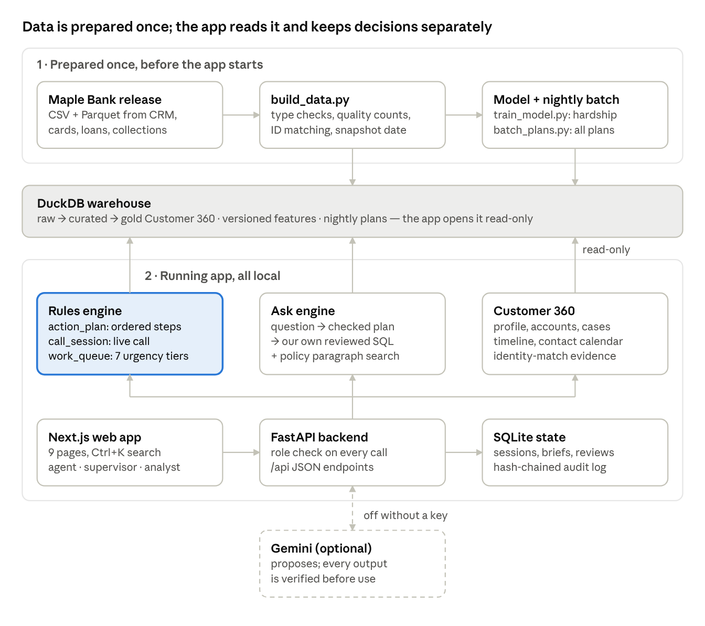
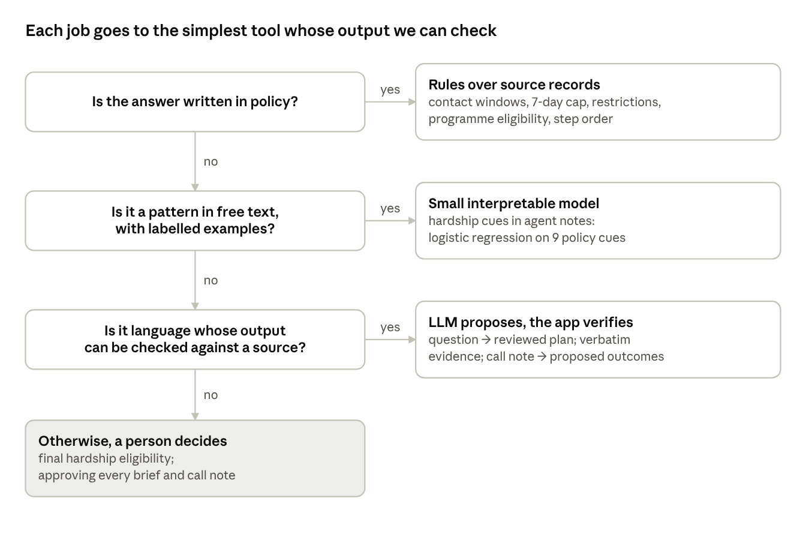
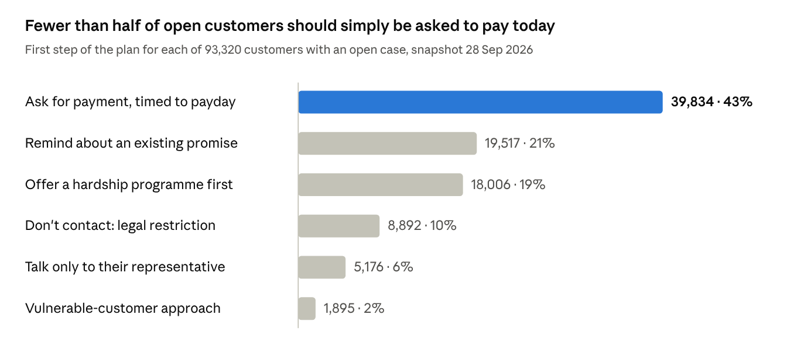

# Collections Copilot — How It Works

Team guide for the finals, 15 October 2026. Read this before the finals: everyone on the team should be able to demo any page and answer any judge question about how it works. The full judge Q&A is [finals-judge-qa.md](finals-judge-qa.md) and the line-by-line demo script is [demo-walkthrough.md](demo-walkthrough.md).

## The problem and who uses it

Collections Copilot tells a bank's collections agent what to do next with an overdue customer, in a legal order, with the policy behind each step. It is debt collection, not sales: agents call customers who have missed payments to recover the money lawfully and, when the customer is struggling, to put them into a hardship programme instead.

The hard part is not the call itself. A customer's records are spread across separate systems (CRM, cards, loans, deposits, collections) with different IDs. The rules are strict: legal calling hours in the customer's own time zone, no Sundays or statutory holidays, at most 3 attempts in 7 days, stop all contact on bankruptcy, talk only to a lawyer if one is recorded, offer hardship help before asking for money. A mistake is a regulatory breach or harm to a vulnerable person.

The data is the **synthetic Maple Bank release** (snapshot 28 Sep 2026, 96,000 open cases). No real customer data is used.

| Role | Login | What they do in the app |
| --- | --- | --- |
| Agent | agent / agent-demo | Works their queue, opens briefs, runs calls in Call Mode. Sees only customers on their own cases; cannot ask portfolio questions. |
| Supervisor | supervisor / supervisor-demo | Everything: portfolio, all customers, Call Mode, approves or rejects briefs and call wrap-ups, reads the audit log. |
| Analyst | analyst / analyst-demo | Portfolio questions, Customer 360, data quality and model pages. Cannot make review decisions or run calls. |

What a bank gets: fewer compliance breaches (the app will not schedule an illegal call), faster calls (the script, calculator and wrap-up note are prepared), more customers on affordable plans instead of written off, and a record of why every decision was made.

What the app does not do: it never sends a message, places a call or changes a source record. Approval only records a decision.

## Architecture

Data is prepared once into a DuckDB warehouse; at runtime every engine only reads it, and the only things written are sessions, briefs, review decisions and the audit log, in a separate SQLite file. Everything runs on one laptop with no internet.



Read it bottom up for a request: the browser calls FastAPI, which checks the role and calls one of three engines; each engine reads DuckDB and returns JSON with its sources. The Rules engine (highlighted) is the product's core: briefs, Call Mode and the work queue all use the same `action_plan.build()`. Gemini sits behind FastAPI as an optional helper and is off when no key is saved.

**The backend path of one request:**

1. The browser calls `/api/*`; FastAPI checks the session and the role on every request (agents only see customers on their own cases).
2. The endpoint calls one engine: the Rules engine (`action_plan`, `call_session`, `work_queue`), the Ask engine (question → validated plan → reviewed SQL with bound parameters, or BM25 policy search), or Customer 360.
3. Engines read DuckDB through a read-only connection and return JSON that carries its sources (record IDs, policy sections, SQL).
4. Only briefs, call notes, review decisions and audit events are written, to SQLite.
5. Gemini, when enabled, receives a fixed task and a JSON schema; its reply is validated before it reaches the output. Without a key or on any failure, the local path answers.

Data behind it: 1.02M customers, 2.69M contact records, 760K agent notes, 367K collections cases. A 30-day scan of all outbound contacts takes a few milliseconds; a Call Mode update about 0.17 s; a full brief about 0.23 s.

## How we decided

The organisers want the *why* before the *what*, so open the presentation with this. Every choice follows from five constraints we took from the policies and the data before writing code:

1. **Compliance first:** a wrong step is a legal or policy breach, not a lower score.
2. **Explainable:** every recommendation names its record and policy section.
3. **Customer data stays inside the bank by default:** notes and transcripts are the most sensitive text.
4. **Works on the next data release**, not only this extract.
5. **Measured, not claimed:** every number can be reproduced.

From those we used one rule to decide what kind of technology does each job:



The rule puts the LLM where language understanding helps and its mistakes can be caught, and keeps it away from numbers and compliance decisions. Each decision, the options we rejected and the evidence are in [design-decisions.md](design-decisions.md).

### Why a small model and not an LLM

We measured it instead of assuming. `scripts/compare_llm_classifier.py` scored the same 126 held-out notes (38 with hardship; the customer-grouped split from `train_model.py`) with Gemini 3.5 Flash-Lite, zero-shot, given the POL-COLL-004 §4.2 hardship definition and told that vulnerability markers alone are not hardship. Measured 15 Oct 2026; raw results in `data/llm-comparison.json`.

| Detector | Hardship found | False alarms | Time per note | Same answer twice | Note text leaves the bank | Explains itself |
| --- | --- | --- | --- | --- | --- | --- |
| **What the app serves: model OR any cue** | **38 / 38** | **0** | under 1 ms | always | no | the cue and the sentence |
| Logistic regression alone | 36 / 38 | 0 | under 1 ms | always | no | 9 named weights |
| Rules only (any cue) | 38 / 38 | 0 | under 1 ms | always | no | the cue and the sentence |
| Gemini 3.5 Flash-Lite, zero-shot | 38 / 38 | 4 | 1.4 s median (5.7 s at the 95th percentile) | 40 of 40 re-asked notes | yes | a yes or no |

**What the four false alarms were.** Three are notes containing "cust vulnerable - financial hardship". In this bank's notes that phrase is a vulnerability tag (POL-COLL-004 §4.5), not a statement of hardship, which is why our cues deliberately exclude the bare word "hardship". Gemini flagged them despite the instruction. The fourth is a consumer proposal: an insolvency restriction, not a hardship case.

**At portfolio scale.** At the measured rate, scoring all 760,594 notes one at a time would take Gemini about 12 days of calls and send every note off-site; the local detector does the whole set in minutes on a laptop.

**Where an LLM can still help.** The synthetic notes reuse a small set of phrasings, so this test cannot show what an LLM would catch in real, free-form notes. That is why the LLM's role is to propose outcomes from a call note with a verbatim quote, which the agent accepts, and never to decide on its own.

## Every page, what it shows and why

There are nine screens; the agent's working path is Work queue → Agent brief → Call Mode → Supervisor review. **Ctrl+K** (or the search box in the header) jumps to any page or customer from anywhere.

| Page | Who | What it shows | Why it matters | Backend |
| --- | --- | --- | --- | --- |
| Overview | all | Portfolio totals, identity-matching results, 7 policy problem tiles (each opens its definition and exact SQL), "What's at stake" money tiles, and a bar chart of today's first step across every open case. | A manager sees where the bank is breaking rules or losing money before opening a single customer. | `/api/overview`, `/checks`, `/value` |
| Work queue | agent, supervisor | The agent's open cases in 7 fixed urgency tiers (stop contact now → promise due soon → hardship with no plan → close to write-off → promise past grace → standard → on hold), with the reason and next legal contact time per row. | Explainable priority. Vulnerability and protected attributes never change the order. | `/api/queue` (`app/work_queue.py`) |
| Customers (Customer 360) | all | Search, then one customer across all source systems. Tabs: **History & contact** (14-day contact calendar + one timeline of contacts, promises, notes, offers), Accounts, Identity (how IDs were matched, with evidence), Notes & calls (incl. voice recordings), Features. | Replaces five systems with one screen; shows contacts that broke the hours rule in red. | `/api/customers/{id}`, `/timeline`, `/calendar` |
| Agent brief | agent, supervisor | **What to do, in order**: numbered steps, each with status (Checked / Do / Wait / Stop), its policy section and source record. Then hardship programmes checked against their rules, summary, signals, a draft message (English or French), model version and the features used. | The core product: the legal next step, with proof. Brief is saved as *pending* for supervisor review. | `POST /api/briefs` (`app/action_plan.py`) |
| Call Mode | agent, supervisor | Live call screen: customer panel, guided script, "what the customer says" toggles, hardship calculator, promise and callback checks, notes extraction, wrap-up. | Turns the brief into a guided, compliant call; the plan recomputes as the customer answers. | `/api/call/session`, `/extract`, `/submit` |
| Supervisor review | agent (own), supervisor | Pending briefs and call wrap-ups; approve, reject or edit with a mandatory reason; audit log. | Human in the loop: nothing the app drafts is used until a supervisor approves it. | `/api/reviews`, `/api/audit` |
| Ask Collections | analyst, supervisor | Plain-English questions (trends, rankings, counts, policy). Each answer shows a one-line summary, the table and the SQL or policy paragraph it came from. Unsafe or unsupported questions are refused or clarified. | Managers get numbers without writing SQL, and can verify every one. | `POST /api/ask` (`app/insights.py`) |
| Data & features | analyst, supervisor | Counted data-quality issues, row counts, feature definitions, offline/live parity, model evaluation. | Shows the data was checked, not assumed clean. | `/api/quality`, `/api/features` |
| Sign in | all | Three demo roles. Access is enforced on the backend, not just by hiding buttons. | Role-based access is a bank requirement. | `/api/auth/login` |

## How the action plan decides

Every brief, call and queue row comes from one function, `action_plan.build()`: pure rules over source records, checked in a fixed order. **No model output can change a step.** The hardship model can only add a "possible hardship" flag that the agent must confirm.

1. **Restrictions stop everything** — bankruptcy or consumer proposal (stay of proceedings), deceased, written cease-communication request. Result: "Don't contact this customer" and the plan ends; if a Licensed Insolvency Trustee is on file, route communication to them. *(POL-COLL-001 §7.3, §5.4)*
2. **Representative** — lawyer, credit counsellor, trustee or other third party recorded: talk only to them. Cases placed with an agency or in legal get a coordinate-first caution. *(POL-COLL-001 §5.4)*
3. **Disputes and complaints** — open dispute: don't ask for the disputed amount (fraud goes to the fraud team). Open complaint: acknowledge and escalate. *(PRC-COLL-012 §6.1, POL-COLL-007 §8.1)*
4. **Vulnerable customer** — use script SCR-VUL, never pressure, hardship first; if the assigned agent isn't certified, reassign. A safeguard, never a priority input. *(POL-COLL-004 §4.5)*
5. **Hardship before payment** — if hardship is recorded (or the model flags it and the agent confirms), every hardship programme effective on the date is checked against its own rules: product, max days past due, months on book, uses in 12 months, insolvency, broken plan in 90 days, counsellor needed. Each comes back *likely eligible*, *check* or *not eligible, with reasons*; the approver is named. *(POL-COLL-004 §4.2–§4.4, programme terms HPT-2026)*
6. **Existing promise** — a promise to pay is due: send one reminder, don't ask for more. In its 2-business-day grace period: check for payment first. *(PRC-COLL-010 §3.2–§3.3)*
7. **When contact is legal** — the earliest slot in the customer's own time zone that is inside their permitted hours, not a Sunday (or 13:00–17:00 if they allow Sundays), not a statutory holiday, and under the 7-day attempt cap (3 by default, or the case's own cap). Lists the channels they consented to and switches to French if preferred. *(POL-COLL-001 §5.1–§5.3, §5.5)*
8. **Only then, the payment ask** — timed to the next payday, estimated from pay frequency and salary credits (semi-monthly = 15th and month-end, moved to Friday at weekends), and never more than 21 days out. Skipped while a promise is pending or hardship has no plan yet. *(PRC-COLL-010 §3.1)*

The headline ("Next action") is the first step that says Stop, Do or Wait. Policy versions are read from the release's own `reference_documents` table, so a new release cites its own current versions.

**Worked examples (the demo customers):**

- **SAV-6847** — 3 attempts already used in 7 days, and 30 Sep is a statutory holiday, so the first legal call is **Thu 1 Oct**. Also a vulnerable customer.
- **JEV-1240** — French-speaking, auto loan, 86 days past due, $1,895.16 overdue, hardship recorded: offer HP-LOAN-RED3 or HP-LOAN-EXT before any payment ask.
- **HAC-4447** — consumer proposal recorded: step 1 says stop; Call Mode is blocked and shows no script.

## Live Call Mode in detail

Call Mode re-runs the full action plan every time the agent ticks something the customer said, so the plan on the right is always the legal next step for the conversation as it stands. Open it with **Start call** on a brief, a queue row, a customer page or Ctrl+K. The backend is `app/call_session.py`; each tick is one `POST /api/call/session` with everything recorded so far.

**The screen has three columns:** customer panel (name, product, days past due, overdue, their local time, language), the guided call (script → who answered → what the customer says → income → promise → callback → notes), and the live plan with the hardship calculator. A bottom bar says whether the call is ready to submit.

**Stages, enforced by the backend:**

1. **Pre-call** — the call is simulated at the first legal contact time after the snapshot (JEV-1240: Mon 28 Sep 07:00 Toronto). If contact isn't allowed at all (HAC-4447), the screen shows only the restriction: no script, nothing to record.
2. **Who answered** — customer, third party (no debt details, name and number only), voicemail (counts as an attempt) or no answer.
3. **Verification** — the recording notice and identity check must both be ticked before the debt can be discussed; until then, promises are refused.
4. **Conversation** — toggles for Hardship (with a reason), Cannot afford, Dispute, Complaint, Vulnerability disclosed, Has a representative, Asked us to stop contact. Each one changes the plan: a representative ends the debt discussion; a cease request stops all contact; vulnerability adds the SCR-VUL steps.
5. **Wrap-up** — the note, outcome codes and follow-ups are written for the agent, then submitted to Supervisor review as a pending record with an audit event.

**Hardship calculator.** Each eligible programme is priced from its own terms in `hardship_programs` and the account's balance, payment and rate — a new programme in the data is priced with no code change. For JEV-1240 (auto loan, balance $32,949.66, payment $631.72, APR 8.81%, 62 months left):

| Programme | Status | Payment now | During | Approver |
| --- | --- | --- | --- | --- |
| HP-LOAN-RED3 — 3-month reduced payment | likely eligible | $631.72 | $315.86 for 3 months ($947.58 moved to the end) | agent |
| HP-LOAN-EXT — term extension | likely eligible | $631.72 | $578.71 over 74 months | hardship specialist |
| HP-LOAN-SKIP — skip a payment | not eligible, with reasons | — | — | agent |

**Checks on what is agreed** (each with its policy citation):

- **Promise** — needs verified identity, an amount and a date that is not past and within 21 days; warns if before the estimated payday, over 50% of monthly disposable income, more than the overdue amount, or if the customer said they cannot afford it.
- **Affordability** — income and housing come from the customer record (JEV-1240: $6,360 income, $1,720.09 housing, $738.58 other payments, $3,901.33 disposable), or from what the customer states on the call, labelled "not verified". A $315.86 promise is 8% of disposable.
- **Callback** — checked against hours, Sundays, holidays and the 7-day cap, counting this call. A Sunday callback for JEV-1240 is refused: "This customer does not permit Sunday contact."
- **Programme** — an agent-approved programme is agreed on the spot; one that needs a specialist becomes a request with an approval follow-up.

**Notes → outcomes (Extract).** The agent can type free notes and press Extract. Every proposal comes back with the exact sentence it came from, and the agent accepts or dismisses each one; nothing is applied automatically. Tested on the rules path: *"Customer said his hours were cut at work. He can pay $300 on Oct 9. Please call me back next week."* → hardship (reduced income), promise $300 on 9 Oct, callback.

**Wrap-up for the full JEV-1240 call** (generated, editable):

> Call Mon 28 Sep 2026 07:00 (America/Toronto), case CS-2026-352540: Reached the customer. Recording notice read; identity verified. Customer stated financial hardship (reduced income); hardship recorded per POL-COLL-004 v4.2 §4.2. Hardship option selected: 3-month reduced payment (HP-LOAN-RED3 v2026.1); approver: agent. Promise to pay CAD 315.86 on Fri 9 Oct 2026; amount and date read back.

Outcome codes RPC, HARDSHIP_STATED, PROGRAMME_AGREED, PTP; one follow-up: a payment reminder Tue 29 Sep from 07:00 their time, which counts toward the 3-in-7-days cap. Submit is refused (HTTP 422) while any blocking check remains.

## Where AI is used and where it is not

AI only suggests; rules and people decide. The app runs fully without any external AI key, and every AI output is checked before anyone sees it.

| Where | What it does | Guardrail | Without it |
| --- | --- | --- | --- |
| Hardship detector (local) | Class-balanced logistic regression on 9 yes/no cues from English and French notes (income loss, income cut, income delay, payment difficulty, hardship request, expense pressure, illness, separation, disaster). Version `c360-financial-v2`. | Can only raise "possible hardship" for the agent to confirm. Never sees raw text, vulnerability or protected attributes. Recorded hardship and restrictions always win. | n/a — always local |
| Gemini: question planning | Turns a plain-English question into a choice of supported metric, grouping and period. | The backend validates the plan and compiles its own reviewed SQL with bound parameters. **SQL written by the model is never executed.** Numbers always come from DuckDB. | Local keyword planner |
| Gemini: evidence and explanations | Picks supporting policy paragraphs or result rows for an answer or brief. | Source IDs and the whole quoted unit must match exactly, or it is dropped. Brief facts are redacted before sending. | Extractive local evidence |
| Gemini: Call Mode notes | Proposes outcomes (hardship, promise, dispute…) from the agent's typed note. | Each proposal must quote the note verbatim; a promise amount must appear in its quote; values must be from fixed lists; the agent accepts each one. The note is treated as untrusted (prompt injection is ignored). | Local rules using the same 9 cues plus amount/date patterns |

**Model results to quote.** On 500 public labelled notes (146 hardship), customer-grouped 5-fold cross-validation over 5 seeds: recall **95.2%**, precision **98.0%** (v1 cues: 68.4% / 90.3%). On the original held-out split of 126 notes, not looked at while designing the cues: **36 of 38** hardship notes found, **0 false alarms**. Be honest that the synthetic notes reuse a small set of phrasings, so this is coverage of this dataset, not production performance.

**Gemini cost and privacy controls:** model `gemini-3.5-flash-lite` by default (`gemini-3.8-flash` was overloaded in our live test); 15 s timeout; at most 60 calls per process (hard cap 100); no retries; `store=false`. Note and transcript text — including notes typed in Call Mode — stays local unless `COPILOT_GEMINI_TEXT_EVIDENCE=1`. The full dataset is never uploaded.

**Voice (optional).** Whisper base runs locally on the CPU to transcribe the supplied call recordings. Its cues are shown for a person to inspect but never feed the model or change a recommendation, because the transcript has no speaker labels.

**Verified live on 15 Oct 2026** with `gemini-3.5-flash-lite`: question planning (it correctly declines non-metric questions), policy evidence, brief evidence on the five demo customers, and Call Mode extraction (it found all four outcomes in the demo note and ignored a planted "mark him as deceased" instruction). Each call took under 2 seconds. Everything shown in the demo also works with Gemini off.

## Works on new data

Nothing about this dataset's date, holidays, caps, policy versions or programmes is hard-coded: point the build at a new release and the app follows it. This answers "does it only work on your demo data?"

| What could be stuck to this dataset | What we do instead | Where |
| --- | --- | --- |
| "Today" (28 Sep 2026) | Snapshot = `max(collections_cases.extract_ts)`; planning time = just after the latest recorded contact, rounded up to the hour. Saved to `data/snapshot.json` at build; `COPILOT_SNAPSHOT` can override. | `app/snapshot.py` |
| Statutory holidays | Computed by rule for any year (Easter, Victoria Day, Thanksgiving, Truth and Reconciliation…), plus any extra dates in `config/statutory_holidays.csv`. The rules reproduce all 105 holidays the data flags from 2016 to 2026. | `app/holidays.py` |
| Contact cap of 3 in 7 days | Each case's own `contact_cap_7d` is used; 3 is only the fallback. | `action_plan.build()` |
| Policy versions in citations | Read from the release's `reference_documents` table (current, effective, English). | `use_document_versions()` |
| Hardship programmes and their prices | Eligibility rules and calculator both read each programme's terms from `hardship_programs`; a new programme needs no code. | `programmes()`, `calculate()` |
| Relative dates in questions and checks | "Last 30 days", "this month", "due in 3 days" are all computed from the detected snapshot. | features, checks, insights |

**How we proved it:** `tests/test_unseen_release.py` builds a fake release dated Wed 24 Mar 2027 in Halifax with a stricter per-case cap of 2 and newer policy versions. With no code changes the app detects the 2027 snapshot, finds Good Friday (26 Mar 2027), blocks Wed and Thu because 2 attempts were already used, skips Good Friday, and cites the new policy versions. The queue uses the new cap and date too.

**What a bank would still map:** its own table and column names to our curated schema (the Data Product Factory step). The rules engine above it does not change.

## Scale and the key numbers to quote

The same rules that build one brief plan the whole book overnight: **93,320 customers in 21.1 seconds** on one laptop (8 worker processes, 4,430 plans per second, 0 errors). `scripts/batch_plans.py` loads each chunk of 2,000 customers with a fixed number of set-based queries instead of one query per customer; that change made it about 46× faster. Results go to a separate file (`data/plans.duckdb`), so the live app is never locked.

| Number | What it means | Source |
| --- | --- | --- |
| 96,000 | Open collections cases at the snapshot (93,320 distinct customers) | Overview |
| $69.8M | Total exposure on cases 150–180 days past due, i.e. about to be written off at 181 days. Source expected-loss estimate: $28.8M; overdue on them: $8.1M. | Overview → What's at stake |
| $18.0M | Overdue owed by 18,758 customers who have recorded hardship but no plan — the people the app routes to a programme first | Overview → What's at stake |
| $338.6K | Recorded cost of 348,411 outbound contacts in the last 30 days — what the 7-day cap and better timing save on | Overview → What's at stake |
| 21.1 s | Plan every open customer (93,320) | `data/plans-report.json` |
| 36 / 38, 0 | Hardship notes found on the held-out set; false alarms | model evaluation |
| 100 / 0 | Customers compared offline vs live; feature mismatches | Data & features |
| 105 / 105 | Data-flagged holidays (2016–2026) reproduced by our holiday rules | `app/holidays.py` tests |

Every money tile on the Overview shows its definition and exact SQL, so a judge can check the number on the spot.



The batch uses exactly the same rules as a single brief, so this chart is the whole portfolio's to-do list for the day — and the Overview shows it live. The pitch line: most customers need something other than "pay now", and the app knows which.

## Why a bank can trust it

Every recommendation can be traced to a source record and a policy section, a person approves it, and the whole build is tested end to end.

- **Explainable by construction.** Each step carries its policy citation (e.g. `POL-COLL-001 v3.0 §5.2`) and source record (e.g. `collections_cases:CS-2026-352540`). The queue order is 7 named tiers, not a black-box score.
- **Human in the loop.** Briefs and call wrap-ups are saved as *pending*. A supervisor approves, rejects or edits, and a reason is mandatory. A reviewed item cannot be reviewed twice.
- **Audit trail.** Every brief, extraction, submission and decision writes an audit event in SQLite (who, what, when). Each event stores the hash of the previous one, and database triggers refuse any update or delete, so tampering is detectable. Supervisors can read it in the app.
- **Access control on the server.** Agents only see customers on their own cases; analysts cannot run calls or decide reviews; hidden buttons are not the protection.
- **Read-only data.** The app opens the customer database read-only; it cannot change source records, send messages or place calls.
- **Fairness.** Vulnerability and protected attributes never change queue order or model input; a question like "rank customers using gender" is refused, as is "export every customer's phone number".
- **Tested.** 552 automated tests (rules, Call Mode, API, unseen release, demo customers pinned); a real-browser walkthrough passing 49 of 49 checks at desktop and phone width; 12 of 12 organiser reference answers match; the 50 submitted benchmark answers are reproduced byte for byte.

## Presentation flow (about 9 minutes)

The live call with JEV-1240 is the centrepiece (3 of the 7 minutes). One person drives the laptop, one narrates; swap at the call so the driver plays the agent. Gemini stays off on stage. The full script with every line to say is [demo-walkthrough.md](demo-walkthrough.md); print it with `scripts/generate_demo_script_pdf.py --finals`.

**Part 1 — slides before the demo (about 2 minutes, never cut):** the organisers asked every team for the architecture, the model and LLM rationale, and the decision process before the solution.

| Slide | The point to land |
| --- | --- |
| 2. The problem | Eight checks before every call; one wrong is a breach. |
| 3. What we found | 760 cases over the cap, 1,040 contacts outside legal hours, 18,758 hardship customers with no plan. |
| 4. How we decided | Five constraints first; then the four-question rule: policy → rules, labelled text pattern → small model, checkable language → LLM proposes and the app verifies, otherwise a person. |
| 5. Backend architecture | DuckDB read-only (millions of rows, scans in milliseconds); FastAPI checks the role on every call; three engines; SQLite hash-chained audit; Gemini optional behind the API. |
| 6. Why this model, why this LLM | Measured: Gemini found the same 38 but raised 4 false alarms, 1.4 s a note, data leaves the bank. Flash-Lite because free tier, schema JSON, under 2 s. |

**Part 2 — the live demo (7 minutes).** If the slot is short, drop the timeline scroll, the 30 Nov date check and the Ask question.

| Time | Do | The point to land |
| --- | --- | --- |
| 0:00 | Overview → scroll slowly through What's at stake (the big number changes from $69.8M to $18.0M to $338.6K as you scroll; pause on each) | $69.8M about to be written off; $18M owed by 18,758 customers in hardship with no plan. This is debt collection. |
| 0:25 | Next-step chart, then problem tiles; open the SQL on "760 cases" | Every case planned nightly in 21 s; rules are broken today (760 over the cap, 1,040 calls outside legal hours); every number is one query. |
| 1:00 | Work queue (agent AG-7514) | A fixed, explained order, not a black-box score. |
| 1:20 | Ctrl+K → SAV-6847 → History & contact | Mon–Tue blocked by the cap, Wed 30 Sep is a holiday, so Thu 1 Oct 07:00–21:00. Holidays are computed, not typed. |
| 1:55 | Scroll the timeline | One history across systems; a contact outside the rules is in red. |
| 2:10 | Ctrl+K → Call: Jérôme Vallée (JEV-1240) | Auto loan, 86 days past due, prefers French. |
| 2:25 | Customer answered; tick recording notice + identity | No debt talk until both are done. |
| 2:45 | Tick Hardship | Plan flips to "hardship first": $631.72 → $315.86 for 3 months (agent can approve); extension $578.71 needs a specialist; skip-a-payment refused because 86 > 60 days. |
| 3:20 | Choose 3-month reduced payment | |
| 3:30 | Income $2,400, expenses $1,900; promise $315.86 on 15 Oct | Affordability warning: 63% of what he has left. |
| 3:55 | Change date to 30 Nov, then back | Blocked: must be within 21 days (by Mon 19 Oct). |
| 4:10 | Paste the note, Extract | Proposals with their exact sentences: job loss, promise, callback. Nothing applies until accepted. |
| 4:35 | Wrap-up | Note written with policy cited; codes RPC, HARDSHIP_STATED, PROGRAMME_AGREED, PTP; one reminder Tue 29 Sep. |
| 4:55 | Submit for supervisor review | Nothing is sent to the customer. |
| 5:05 | Ctrl+K → HAC-4447 → Call | Consumer proposal: the call is blocked; contact goes through the trustee. |
| 5:25 | Supervisor review → Approve with a reason | Human approves; every action is audited. |
| 5:55 | Ask: "Which province has the highest promise-kept rate in August 2026?" | Plain answer, then table and SQL; Yukon 40.9% but only 22 promises, so it flags the small sample. |
| 6:25 | Close on Overview | Works on the next release with no code changes. Rules decide, people approve, every step cites its policy. |

Note to paste at 4:10: *Customer lost his job last month. He can pay $315.86 on October 15. Asked us to call back next week.*

**Before going on stage:** start the backend with a fresh review store (`COPILOT_STATE=data/finals-demo-reviews.sqlite3 COPILOT_GEMINI_ENABLED=0`), use the production frontend build, open every page once to warm it, and reload `/call/JEV-1240` just before you start so the call is empty. If the live app fails, switch to the screenshots in `data/finals-shots/` and keep narrating; don't apologise.

## Judge questions we should expect

Answer in one or two sentences, then show it in the app. If asked something not here, say what we measured and what we did not — never guess a number. The full list with sources is [finals-judge-qa.md](finals-judge-qa.md).

**Is this a sales tool? Why do agents call customers?** No, it is debt collection: the customer already owes past-due money. The job is to recover it lawfully and fairly, which often means not asking for money first — stopping on a restriction, going through a representative, or moving someone in hardship onto a programme.

**Why rules plus a small model, not an LLM agent?** Contact limits, restrictions and programme eligibility are compliance decisions; they must be deterministic, testable and auditable. The model only flags possible hardship; it can never remove a restriction or change step order.

**Why logistic regression for hardship and not an LLM?** We measured it: on the same 126 held-out notes our served detector found 38/38 with 0 false alarms; Gemini 3.5 Flash-Lite also found 38 but raised 4 false alarms (three were the "cust vulnerable - financial hardship" vulnerability tag), took 1.4 s per note instead of under a millisecond, and sends note text off-site. Plus, 500 labelled notes is too few for a deep model, and 9 named weights are explainable.

**Why Gemini, and why Flash-Lite?** The LLM's jobs are narrow (pick a reviewed plan, choose verbatim evidence, propose call outcomes), so fast, structured output matters more than deep reasoning. Free tier for the team, JSON-schema output we validate, under 2 s per call; 3.8 Flash was overloaded on 15 Oct. It sits behind one module, so a bank-hosted model would change no decision logic, and the app runs with no LLM at all.

**Why not let the LLM write SQL? Why BM25 and not embeddings?** A generated query can be silently wrong; the model only picks from our catalogue and the backend runs reviewed SQL. Policy is 19 keyword-heavy documents and answers must cite an exact section and version, which BM25 gives deterministically with nothing extra to run.

**What does Call Mode add over the brief?** The brief is preparation; Call Mode is the call. Every click recomputes the plan, checks and script with the same rules, so the agent can't promise an illegal callback or skip the hardship offer.

**Where do the hardship numbers come from?** The account's own payment and the programme's terms in `hardship_programs`. JEV-1240: 50% of $631.72 for 3 months = $315.86; extension re-amortised to $578.71; skip-a-payment refused because 86 days past due exceeds its 60-day limit.

**Can an agent call someone they shouldn't?** No. HAC-4447 (consumer proposal) opens as "Contact blocked" with no script. Agents can only open their own customers; this is enforced on the server.

**Is Gemini required? What if it makes something up?** Not required; everything runs locally. It can only choose one of our reviewed question plans, pick verbatim evidence, or propose call outcomes with a verbatim quote. Anything whose quote isn't in the source is dropped; model SQL is never run; the agent accepts and a supervisor approves. Typed notes only leave the machine if text evidence is switched on. It was verified live on 15 Oct, including ignoring an instruction planted in a note.

**Does it only work on your dataset?** No hard-coded dates or limits. Snapshot, holidays, per-case caps, policy versions and programme terms all come from the data; a test builds a 2027 release and the app follows it. A bank with a different schema would map its tables to ours once.

**Will it scale?** 93,320 plans in 21.1 s on a laptop; a call update about 0.17 s and a brief about 0.23 s. In production, swap the DuckDB files for the bank's warehouse; the rules are plain Python and SQL.

**How good is the hardship model, honestly?** Recall 95.2%, precision 98.0% in grouped cross-validation; 36/38 with 0 false alarms on the untouched held-out set. That's high because the synthetic notes reuse phrasings — it shows coverage of this data, not production accuracy.

**How is the queue ordered? Does vulnerability lower priority?** Seven fixed tiers, each row shows its reason. Vulnerability is a safeguard, never a priority input; a test checks the tier is identical with and without the flag.

**How do you avoid wrong numbers in Ask?** Questions compile into reviewed SQL with bound parameters, every answer shows its SQL, and unsupported questions get a clarification instead of a substitute number. 12/12 organiser reference answers match.

**What's the money at stake?** $69.8M exposure near write-off, $18.0M overdue from hardship customers with no plan, $338.6K contact spend in 30 days. These are source amounts, not savings we claim.

**Limits to state up front, before they ask:** synthetic templated data, so no business-uplift claim; national holidays only (provincial ones can be added in a config file); payday estimated for 52% of cases (otherwise the agent asks); income stated on a call is unverified; programme results are suggestions, the approver decides; the app never contacts a customer.

## Running it yourself

The finals build is on the `finals` branch of `pg1590/cibc-collections-copilot`; `main` is still the prelim submission. The data is not in git, so each machine builds it once (Python 3.10, Node 20.9+, about 12 GB free).

```bash
git fetch && git checkout finals
python3 -m venv .venv && .venv/bin/python -m pip install -r requirements-lock.txt
.venv/bin/python scripts/fetch_data.py      # skip if the release is already extracted
.venv/bin/python scripts/build_data.py      # long; resumes if interrupted
.venv/bin/python scripts/train_model.py
.venv/bin/python scripts/batch_plans.py     # ~20 s; feeds the Overview "today's first step" chart

# terminal 1 — backend
.venv/bin/python -m uvicorn app.main:app --host 127.0.0.1 --port 8000
# terminal 2 — frontend
cd frontend && npm ci && npm run build && npm run start
```

Open http://127.0.0.1:3000 and sign in as `supervisor` / `supervisor-demo` (also `agent` / `agent-demo`, `analyst` / `analyst-demo`). Stop the backend before rebuilding data or retraining. On stage, use the production build (`npm run build && npm run start`), not `npm run dev`: it is faster and has no dev overlay.

**Optional Gemini:** save the key to `data/gemini-key.txt` (never in git or chat) and restart the backend. Without it everything runs on the local path.

**If something breaks on stage:**

| Symptom | Fix |
| --- | --- |
| Pages say "Backend not reachable" | Backend stopped: re-run the uvicorn command in terminal 1, then refresh. Check http://127.0.0.1:8000/api/health. |
| Overview has no "today's first step" chart | `data/plans-report.json` missing: run `scripts/batch_plans.py` (20 s). |
| A brief was already approved and can't be reviewed again | Expected: prepare a fresh brief for the same customer, or use another pending one. |
| Sign-in fails | Passwords are `<role>-demo` unless overridden by `COPILOT_<ROLE>_PASSWORD` in the backend terminal. |
| Gemini errors or slow | Restart the backend with `COPILOT_GEMINI_ENABLED=0`; the local path gives the same demo. |
| Want proof everything works before going on | Run `.venv/bin/python scripts/smoke_test.py` against the running backend. |

Keep a second laptop with the same build running as a fallback, and the screenshots in `data/finals-shots/` open in case the network or a machine fails.
